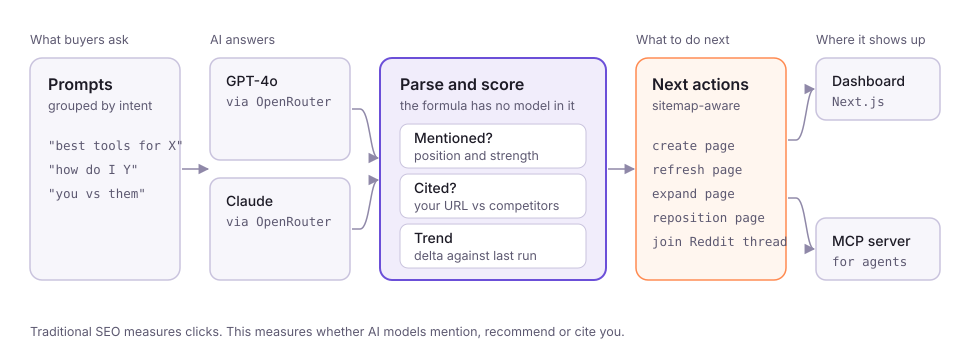

# GEO Visibility Tool

[](https://github.com/alfielambert/geo-visibility-tool/actions/workflows/tests.yml)
[](LICENSE)

Find out whether ChatGPT and Claude recommend your brand, and which page to write next to change that.

A self-hosted tool that tracks your brand's visibility inside AI-generated answers. I built it to track LookC and Oiya; the seed data is the LookC setup.

<p align="center">
  
</p>

Traditional SEO measures clicks from search engines. This measures whether AI models **mention, recommend, or cite** your brand when users ask questions in your category. Sometimes called Generative Engine Optimisation (GEO) or Answer Engine Optimisation (AEO).

Built with Next.js, Drizzle ORM, and OpenRouter.

---

## What it does

- **Runs prompts** across GPT-4o and Claude simultaneously: the questions your buyers actually ask AI assistants
- **Extracts structured observations** from each response: is the brand mentioned? what position? what strength? which competitors appeared? what was cited?
- **Scores visibility** using a deterministic formula across mention strength, position, citation rate, and volatility
- **Generates recommendations**: content gaps, Reddit thread opportunities, and (with site inventory loaded) whether to create a new page or refresh an existing one
- **Tracks trends**: compares each run to the previous to show whether visibility is improving or declining
- **MCP server**: exposes all data as tools so Claude Code agents can query and act on visibility data programmatically

---

## Tech stack

| Layer | Choice |
|---|---|
| Framework | Next.js 16 (App Router) |
| Database | SQLite via libsql (dev) / PostgreSQL-compatible (prod) |
| ORM | Drizzle |
| LLM engines | OpenRouter (GPT-4o + Claude Sonnet) |
| Recommendations | Claude Sonnet via OpenRouter |
| MCP server | `@modelcontextprotocol/sdk` |
| UI | Tailwind CSS v4 |

---

## Setup

### 1. Install dependencies

```bash
cd app
npm install --legacy-peer-deps
```

### 2. Configure environment

```bash
cp .env.example .env
```

Edit `.env` and add your [OpenRouter](https://openrouter.ai) API key:

```
OPENROUTER_API_KEY=sk-or-v1-...
```

### 3. Initialise the database

```bash
node scripts/migrate.mjs
node scripts/seed.mjs
```

Edit `scripts/seed.mjs` first to set your brand name, domain, competitors, and prompts.

### 4. Start the dev server

```bash
npm run dev
```

Open [http://localhost:3000](http://localhost:3000).

---

## Adding your prompts

Prompts are the questions your buyers ask AI assistants. They're organised into clusters by intent. Edit `scripts/seed.mjs` or add them via the web UI at `/projects/new`.

Good prompts:
- "What are the best tools for [your category]?"
- "How do I [core problem you solve]?"
- "[Your brand] vs [Competitor], which should I use?"
- "What do people recommend for [use case]?"

---

## MCP server

The `mcp-server/` directory exposes the tool as an MCP server so Claude Code agents can interact with it directly.

```bash
# Install deps
cd mcp-server && npm install

# The server talks to the Next.js app running on localhost:3000
VISIBILITY_API_URL=http://localhost:3000 npx tsx index.ts
```

Available tools: `list-projects`, `get-overview`, `trigger-run`, `get-run-status`, `get-recommendations`, `get-prompts`.

The `.claude/settings.json` file registers the server automatically when you open the project in Claude Code.

---

## Cannibalisation check

Before recommending "create a new page", the tool checks your site's existing pages and semantically compares the recommendation topic against them. It classifies each recommendation as:

- **Create**: no existing page covers this intent
- **Refresh**: existing page exists but needs updating
- **Expand**: existing page covers it too narrowly
- **Reposition**: existing page targets the wrong angle

Import your sitemap to enable this:

```bash
curl -X POST http://localhost:3000/api/site-pages \
  -H "Content-Type: application/json" \
  -d '{"sitemapUrl": "https://yourdomain.com/sitemap.xml"}'
```

---

## Project structure

```
app/
├── src/
│   ├── app/                  # Next.js pages + API routes
│   │   ├── api/              # REST endpoints
│   │   └── (pages)/          # Dashboard, runs, prompts, recommendations
│   └── lib/
│       ├── collector/        # Prompt runner (fires prompts at engines)
│       ├── engines/          # OpenRouter, GPT-4o, Claude adapters
│       ├── parser/           # Extracts structured data from LLM responses
│       ├── scoring/          # Deterministic visibility score formulas
│       ├── recommendations/  # Opportunity detection + narrative generation
│       └── site-inventory/   # Sitemap fetcher + cannibalisation check
├── mcp-server/               # MCP server for agent access
└── scripts/                  # migrate.mjs, seed.mjs
```

---

## Scoring

Visibility is scored deterministically. No LLM is involved in the formula. The score for each prompt is a weighted combination of:

- **Brand mentioned** (binary)
- **Position** in the response (1st = highest)
- **Mention strength** (strong / moderate / weak / none)
- **URL cited** (brand domain appears in citations)
- **Primary recommendation** (brand is the lead answer)

Scores are aggregated per cluster and across the whole project. Each run computes a delta against the previous run.

---

## Licence

MIT. See [LICENSE](LICENSE).
